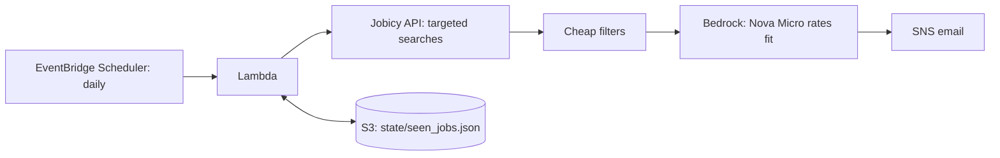

# terraform-job-alerts

Daily job alerts on AWS. A Lambda function pulls remote job listings, filters out roles that aren't realistic, has Amazon Bedrock rate the rest, and emails new matches through SNS. Everything is provisioned with Terraform.

Written up in the article: [Two Terraform Automations That Run My Learning and My Job Search](https://builder.aws.com/content/3MS732YJfM5crdeoTqn3bIcPGDt/two-terraform-automations-that-run-my-learning-and-my-job-search)

## How it works



1. **Fetch:** the Lambda runs targeted searches against Jobicy's public API (tags: devops, aws, terraform, cloud, kubernetes, python, with and without a location filter), merges the results by job ID, and retries failed requests up to three times.
2. **Cheap filters:** the title must match a keyword list, senior-level titles are dropped, and the location must be open to Kenya (anywhere, worldwide, Africa, Kenya, or EMEA).
3. **Bedrock screening:** the remaining jobs go to Amazon Nova Micro with a short description of the candidate. Each job comes back rated `yes`, `stretch`, or `no` with a one-line reason.
4. **No repeats:** IDs of jobs already sent are stored in `state/seen_jobs.json` in S3.
5. **Delivery:** new matches are emailed through SNS. EventBridge Scheduler runs the function daily.

## Repository layout

| Path | Purpose |
|------|---------|
| `src/lambda_function.py` | The Lambda handler, filters, and Bedrock screening |
| `terraform/` | S3 bucket, SNS topic and subscription, IAM roles and policies, Lambda, and the EventBridge schedule |

## Security design

- **Least-privilege S3 access:** the Lambda can only read and write objects under the `state/` prefix. It cannot delete them or read other paths.
- **One Bedrock model:** `bedrock:InvokeModel` is allowed only for the model in use.
- **Scoped SNS permission:** the function can only publish to its own topic.
- **Private bucket:** versioned, encrypted, with public access blocked.

The S3 and Bedrock policies were checked with the IAM policy simulator, including the denials.

## Setup

1. Install Terraform and configure AWS credentials for your account.
2. Review the variables in `terraform/variables.tf`, including the email address that should receive alerts.
3. From the `terraform/` folder run `terraform init`, then `terraform plan`, then `terraform apply`.
4. Confirm the SNS subscription from the email AWS sends you.

## Testing

Preview the candidates without sending anything (needs AWS credentials):

```
python -c "import json; from src.lambda_function import lambda_handler; print(json.dumps(lambda_handler({'dry_run': True}, None), indent=2))"
```

Run the deployed function once:

```
aws lambda invoke --region us-east-1 --function-name job-alerts-function --payload '{}' --cli-binary-format raw-in-base64-out response.json
cat response.json
```

To resend jobs you have already been sent, delete `state/seen_jobs.json` from the bucket first.

## Known limitations and next steps

- Jobicy is the only source, so quiet days can produce no alerts.
- The keyword lists and candidate description live in the code. Moving them into Terraform variables would make them easier to change.
- Alerts arrive as plain-text email.

## Credits

Job listings come from [Jobicy](https://jobicy.com).
